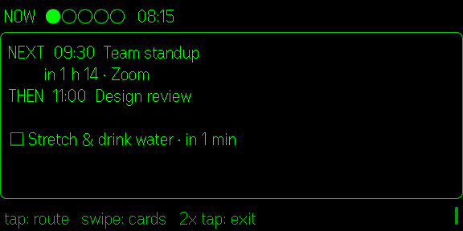
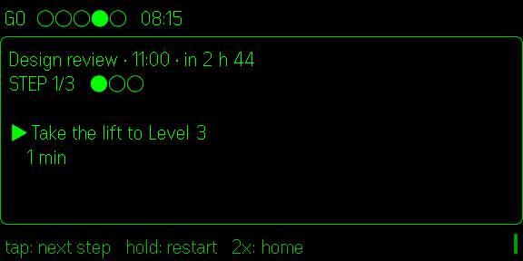
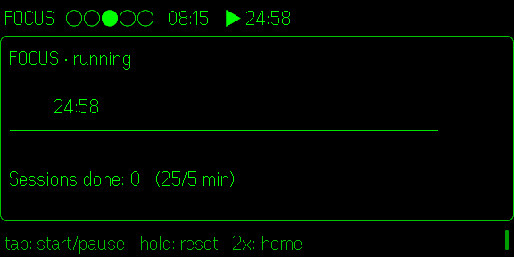
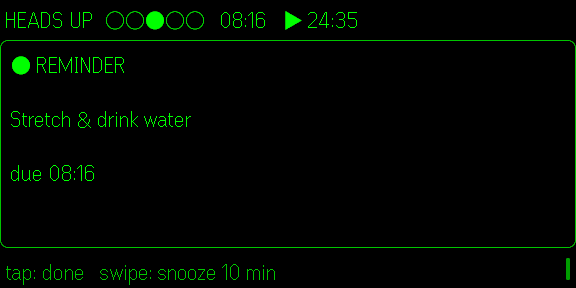
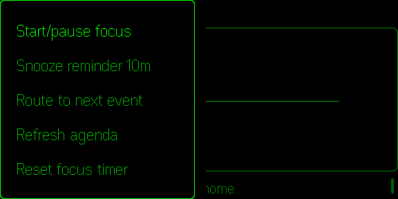

# Glance: a heads-up assistant for Even Realities G2

Entry for **Heads Up: Even Realities Hackathon** on DoraHacks (TVM Ventures × Daos Hub). Proposed track: **Track 04, AI Assistants & Work**.

Glance is a hands-free card deck for the G2 display (576×288, monochrome green). It answers "what's next, and what do I have to do?" without your phone:

| Card | What you see | Tap | Hold |
|---|---|---|---|
| **NOW** | next event + countdown, the one after it, top reminder | route to next event | |
| **AGENDA** | today's timeline, `▶` marks now/next | pick an event (list), tap again to route to it | |
| **FOCUS** | Pomodoro timer (25/5 by default), progress bar, sessions done | start / pause | reset |
| **GO** | turn-by-turn style step cards to the event location (`STEP 1/3 ●○○`) | next step | restart route |
| **REMIND** | pending reminders with due times | mark the first one done | snooze 10 min |

- **Swipe up/down** cycles cards. **Double tap** returns to NOW; a double tap on NOW exits (`shutDownPageContainer`).
- **Heads-up alerts pop up by themselves**: a reminder that is due, an event starting in 5 minutes (tap opens its route), or a finished focus session (the break starts by itself). Tap = done/open, swipe = snooze/dismiss. Alerts close on their own after 20 s.
- A running focus timer stays visible in the header on every card (`▶ 24:35`).
- **Contextual menu** (system long-press): Start/pause focus, Snooze reminder 10m, Route to next event, Refresh agenda, Reset focus timer.
- **Phone companion page** (the WebView's phone screen, or the right side of the browser demo): add/remove reminders, set focus/break minutes, set the calendar source, reset the demo.

 
 
 

*(Screenshots taken from the Even Hub simulator through its automation API.)*

### Calendar data

- **Demo day (default):** without configuration, Glance shows a generated demo day, labelled `DEMO` in the header, so it works with no account and no API key.
- **Your calendar:** set `GLANCE_ICS_URL` to any iCal feed, for example the Google Calendar "Secret address in iCal format". Glance's small proxy (`/api/agenda`) fetches and parses the feed on the server, so the secret URL never reaches the glasses app. `GLANCE_ICS_FILE` reads a local `.ics` file instead.
- The parser (`src/core/ics.ts`) handles UTC, TZID, floating and all-day times; DURATION; DAILY and WEEKLY RRULEs (INTERVAL, COUNT, UNTIL, BYDAY); EXDATE; RECURRENCE-ID overrides; and cancelled events.
- **Route steps:** put lines like `GO: Take the lift to Level 3 | 1 min` in an event's description and the GO card uses them. Without them, Glance builds generic steps: leave by (walk time), head to the location, arrive.

## Run it

### Prerequisites

- **Node.js 22.18+ or 24** (tested with 24.22) and npm. The standalone proxy runs `.ts` directly through Node's type stripping.
- **Linux only:** the simulator needs WebKitGTK: `sudo apt-get install libwebkit2gtk-4.1-0`. macOS and Windows need nothing extra.
- **No accounts:** no Even Realities, Even Hub or DoraHacks account and no API key are needed to build, test or run Glance in the simulator. The simulator ships as an npm dev dependency.

### 1. Install

```bash
git clone https://github.com/ZQ051031/even-realities-hackathon.git
cd even-realities-hackathon
npm install
```

### 2. Start the dev server

```bash
npm run dev                                    # demo day
# or with a real calendar:
GLANCE_ICS_URL='https://calendar.google.com/calendar/ical/.../basic.ics' npm run dev
# or with the bundled sample calendar:
GLANCE_ICS_FILE=fixtures/sample-calendar.ics npm run dev
```

Vite serves the app on http://localhost:5173 and mounts the agenda proxy at `/api/agenda`.

### 3. Open it in the Even Hub simulator

In a second terminal:

```bash
npm run simulate                    # = evenhub-simulator http://localhost:5173
```

The simulator opens two windows: the phone WebView (Glance's companion page) and the glasses display. Use the simulator's touchpad controls: click, double click, swipe up/down, long press.

Scripted or remote demo: start the simulator with its automation server and drive it over HTTP:

```bash
npx evenhub-simulator http://localhost:5173 --automation-port 9898
curl http://127.0.0.1:9898/api/ping                                  # pong
curl -X POST http://127.0.0.1:9898/api/input -H 'Content-Type: application/json' -d '{"action":"down"}'
# actions: click, double_click, up, down, context_menu, long_press, long_press_release
curl -o glasses.png http://127.0.0.1:9898/api/screenshot/glasses     # 576x288 PNG
```

### 4. Browser demo (no simulator)

Open http://localhost:5173/?mock in any browser. A 576×288 mock of the G2 display shows next to the companion page.

| Key | Gesture |
|---|---|
| `↑` / `↓` | swipe |
| `Enter` / `Space` | tap |
| `Esc` / `Backspace` | double tap |
| `L` | long press |
| `M` | contextual menu |

On-screen buttons do the same. Outside the Even Hub WebView, the mock is used automatically.

### 5. Test, build and package

```bash
npm test          # 23 unit tests (vitest): ICS parsing/recurrence, focus timer, state machine, SDK layout validation, event mapping, proxy
npm run build     # tsc --noEmit + vite build -> dist/
npm run pack      # builds and packs out.ehpk with evenhub-cli (local only, nothing is uploaded)
```

The tests validate every card in many states against the SDK's own `validateEvenHubPageContainer`. They also check Even Hub limits: at most 8 containers, exactly one event-capture container, at most 20 list items of 64 characters each, and only glyphs the G2 firmware font renders.

### Optional: standalone agenda proxy

Use this if you host the static `dist/` somewhere else:

```bash
GLANCE_ICS_URL='https://…/basic.ics' PORT=8787 npm run agenda-server
```

Then enter `http://<host>:8787/api/agenda` in the companion page's Calendar field. If that origin is not the app's own, add a network permission/whitelist for it to `app.json` before packing for a real device.

## How it's built

```
src/core/        pure, testable logic: state machine + views (app.ts), ICS parser, focus timer, route steps, page limits
src/platform/    Even Hub renderer (create/rebuild/textContainerUpgrade over a serial queue), browser mock,
                 bridge-or-localStorage persistence, agenda loading with demo fallback, controller
src/companion.ts phone-side settings UI
server/          /api/agenda proxy (Vite plugin + standalone Node server)
test/            vitest suites
```

- Each card is 3 text containers: header, body (the single event-capture container) and footer hint. The agenda picker swaps in a native list container.
- Card switches update text in place with `textContainerUpgrade`. A full `rebuildPageContainer` happens only when the layout changes (deck ↔ list), which keeps BLE traffic low.
- State (reminders, focus timer) is saved with the bridge's `setLocalStorage`, so it survives an app restart.

## Hackathon rules and disclosure

### Build window rules (read on the DoraHacks page, 2026-11-22)

- Build starts **Nov 23, 2026 12:00 Dubai time (GMT+4)**, which is 08:00 UTC and 16:00 HKT/CST.
- Submission deadline is **Nov 29, 2026 23:59 Dubai time**, which is 19:59 UTC and **Nov 30, 03:59 HKT/CST**.
- Rule text: "Build during the hackathon. Open-source libraries and existing APIs are allowed; say in your README what existed before Nov 23."
- Remote demos are allowed and physical glasses are not required (the Even Hub simulator is fine). A submission needs a public repo and a demo video.

### What existed before Nov 23

This is commit `c27f1a9`, the first commit in this repo:

- the official template `even-realities/evenhub-templates/minimal` (Vite + TypeScript + Even Hub SDK), copied unmodified, with only dependency versions bumped
- `PLAN.md` (design notes written during research) and a README skeleton

Everything else was written after the window opened on Nov 23: all of `src/` except the template entry, `server/`, `test/`, `fixtures/`, `docs/`, the UI and this README. Third-party code: only the npm dependencies in `package.json`.

## DoraHacks submission notes (for the team; not submitted)

The submission and demo video are still to do. Nothing has been submitted to DoraHacks.

- **Track:** 04, AI Assistants & Work. Alternative: the general category.
- **Repo:** https://github.com/ZQ051031/even-realities-hackathon (public).
- **One-liner:** "Glance turns your G2 into a hands-free day planner. Your next meeting, a focus timer, gentle reminders and step-by-step 'get there' cards, all one glance and one tap away."
- **Demo video plan (2–3 min, simulator):**
  1. NOW card with the countdown.
  2. Swipe through AGENDA → FOCUS → GO → REMIND.
  3. Tap to start focus and show the header timer on other cards.
  4. Let a reminder pop up, tap done.
  5. Show the 5-minute event alert opening the GO route.
  6. Open the contextual menu.
  7. Phone companion: add a reminder, then load the real calendar with `GLANCE_ICS_URL`.
  8. Close with the hands-free design: one capture container, text-only cards, an alert that hides itself.
- **Disclosure:** copy the "What existed before Nov 23" section above.
- **Known limits:**
  - Tested in simulator v0.9.5 only, not on physical G2 hardware, so BLE timing and real fonts are not verified.
  - Simulator times use the host machine's clock and timezone.
  - The `.ehpk` is not published to Even Hub; that needs a developer account.
